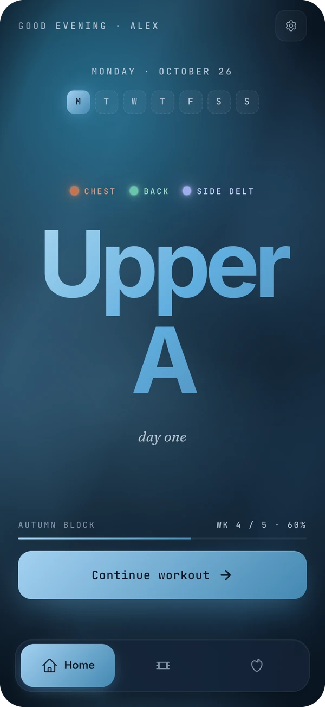
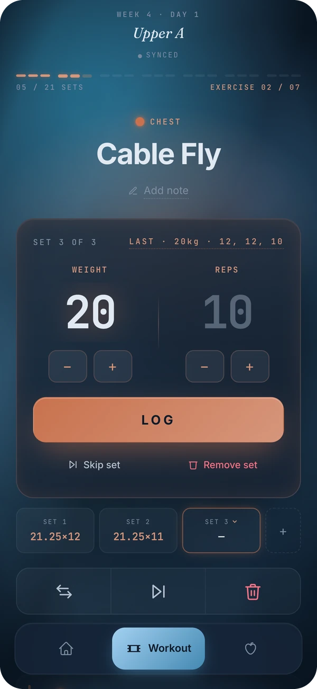
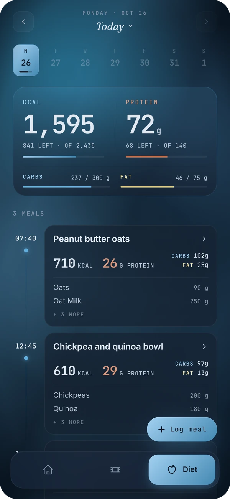
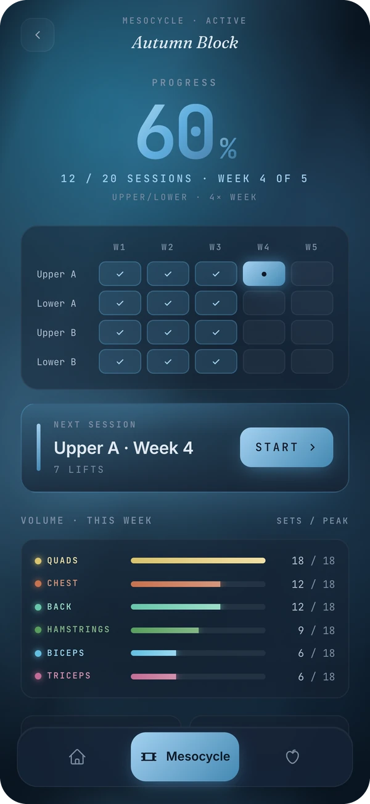
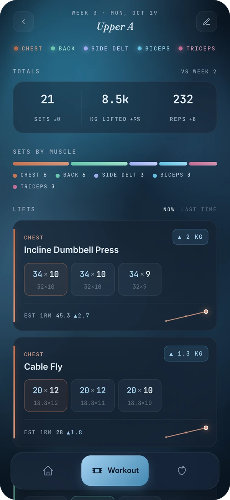
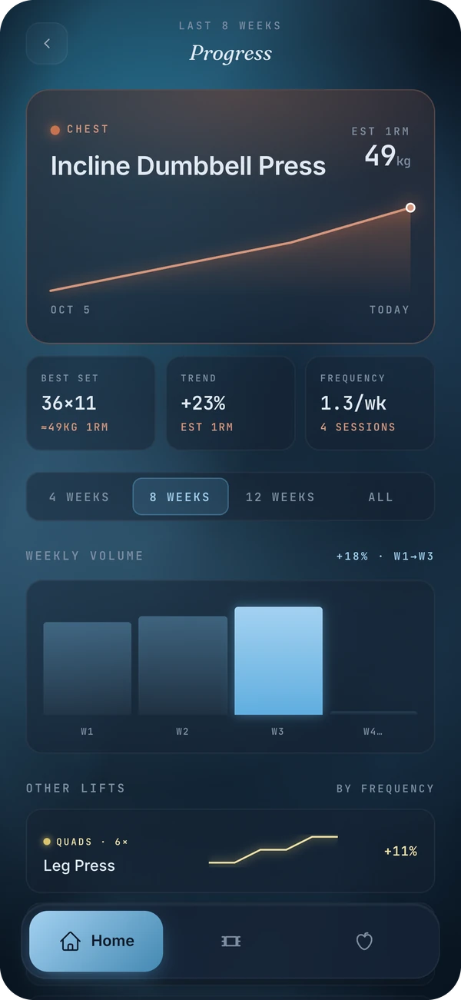
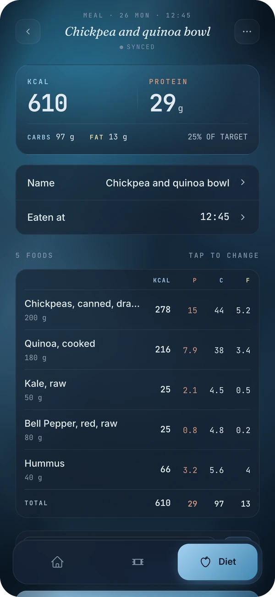
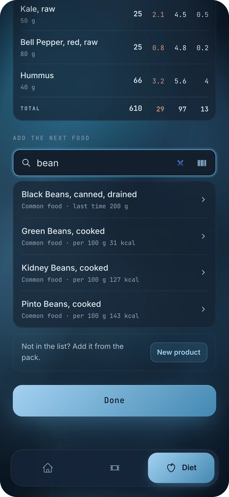
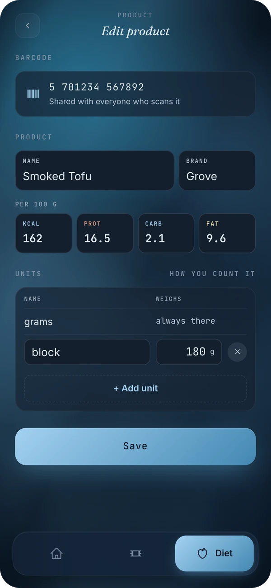
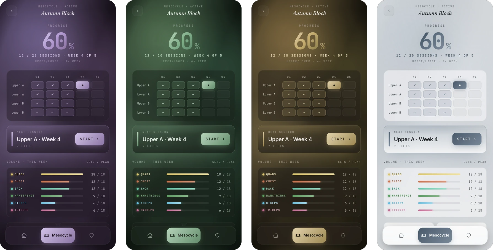

# Protocol

A fitness app for the gym and the kitchen: plan training blocks, log every set,
and track what you eat. It's built for the phone, and it keeps working with no signal.

<p align="center">
  
  &nbsp;
  
  &nbsp;
  
</p>

Protocol is a personal project: a web app you install to your iPhone's home screen
(a PWA), self-hosted on a small server.

## Training

Training is planned in **mesocycles**: blocks of 3–8 weeks built from a split
(Upper/Lower, Push/Pull/Legs, … or your own).

- **One set at a time.** Weight, reps, *Log*. Sets you haven't touched show last
  time's weight and reps, so most sets take a single tap.
- **Change the plan mid-workout.** Skip a set, an exercise or the whole session;
  swap, add or reorder exercises; keep a note on any exercise.
- **The whole block on one screen.** Every session in a grid, where you left off,
  and this week's sets per muscle group.
- **A review after every workout.** Totals against last week, sets by muscle,
  each lift set by set against last time, and estimated 1RM.
- 115 exercises and 6 split templates to start from, plus your own.

<p align="center">
  
  &nbsp;
  
  &nbsp;
  
</p>

## Diet

- **Meals, not slots.** Log what you ate and when; the day is a timeline, with
  calories and macros against your targets.
- **Three ways to add a food:** search, scan a barcode (Open Food Facts), or
  photograph the nutrition label and let Claude read it.
- **Amounts the way you think of them:** grams, or a food's own units (a slice,
  a scoop, a tablespoon), plus units of your own.
- **Meals name themselves.** Claude names and groups each meal in the
  background; a name you type always wins.
- Daily macro targets and a bodyweight log.

<p align="center">
  
  &nbsp;
  
  &nbsp;
  
</p>

## Works offline

Every set and every meal is saved on the phone first and synced in the
background, retrying until the server has it. A gym basement with no signal
doesn't lose anything, and the app opens offline.

## Themes

Fifteen of them, dark and light.

<p align="center">
  
</p>

## Under the hood

- **Frontend:** React, TypeScript, Vite and Tailwind, installable as a PWA, with
  TanStack Query and local drafts for offline use.
- **Backend:** FastAPI, async SQLAlchemy and PostgreSQL, with Alembic migrations.
- **Hosting:** Docker Compose on one VPS, with Caddy serving the app over HTTPS.
- **Claude** (optional): Haiku names meals and Opus reads nutrition labels. Without an
  `ANTHROPIC_API_KEY`, meals show their foods and products are typed in.

The rules behind workouts and meals are written up in
[`docs/WORKOUT-LOGIC.md`](docs/WORKOUT-LOGIC.md) and [`docs/DIET-LOGIC.md`](docs/DIET-LOGIC.md).

## Running it locally

You need Docker and [Bun](https://bun.sh/).

```bash
docker compose up                              # PostgreSQL + API
cd frontend && bun install && bun run dev      # app at http://localhost:5173
```

Log in with the password `devpassword`. Tests, migrations and deployment are covered in
[`docs/DEVELOPMENT.md`](docs/DEVELOPMENT.md).

## Status

In daily use. Up next: [`docs/ROADMAP.md`](docs/ROADMAP.md).

## License

[MIT](LICENSE)
